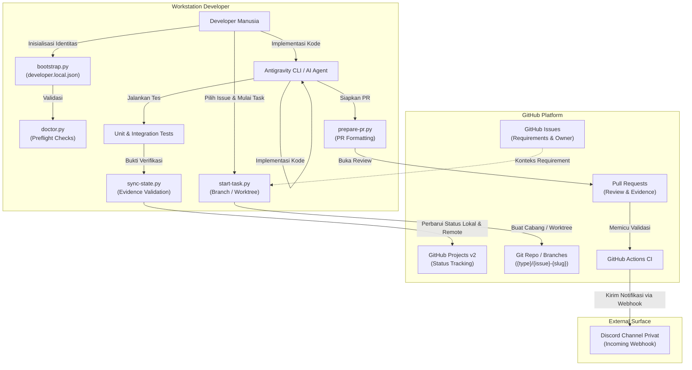

# Arsitektur Koordinasi Supervised Autonomous Development

Dokumen ini mendefinisikan arsitektur koordinasi antara developer manusia dan AI coding agent (Antigravity CLI) pada ekosistem Eva AI.

---

## 1. Filosofi & Operating Model

Nama model: **Supervised Autonomous Development Coordination**.

- **Human-in-the-Loop & Human-Owned**: Setiap pekerjaan memiliki satu human owner yang memegang kendali dan akuntabilitas. Agent bekerja sebagai asisten pair programming yang patuh pada batasan arsitektur, bukan eksekutor tanpa pengawasan.
- **Pemisahan Peran**:
  - **Developer**: Menentukan prioritas, merumuskan prompt, menyetujui keputusan arsitektur, mereview perubahan kode, dan memicu aksi remote berisiko.
  - **AI Agent**: Mengurus konteks lokal, menjalankan diagnostik kesiapan (preflight doctor), membuat cabang kerja terisolasi, mengimplementasikan kode sesuai prompt, memvalidasi bukti pengujian, dan menyinkronkan status pekerjaan.
  - **GitHub Issues**: Sumber kebenaran tunggal (*single source of truth*) untuk kebutuhan fitur, kriteria penerimaan (*acceptance criteria*), dan lingkup kerja.
  - **GitHub Projects v2**: Sumber kebenaran status siklus hidup pekerjaan tim.
  - **Git Branches & Worktrees**: Isolasi perubahan per-task.
  - **GitHub Actions**: Validasi CI otomatis dan pengiriman notifikasi Discord satu arah.
  - **Discord Webhook**: Kanal notifikasi pasif (*read-only*), bukan task tracker atau command orchestrator.

---

## 2. Diagram Alur & Siklus Hidup

---

## 3. Batas Lingkup (Scope Boundaries)

### Dalam Lingkup (Phase 1)
- Identitas developer lokal ter-gitignore (`.agent/developer.local.json`).
- Pemeriksaan preflight deterministik (`scripts/agentic/doctor.py`).
- Konvensi branching dan worktree task-based (`{type}/{issue}-{slug}`).
- Rangkuman tugas read-only (`scripts/agentic/tasks.py`).
- Sinkronisasi status berbasis bukti (`scripts/agentic/sync-state.py`).
- Format Pull Request terstandar (`scripts/agentic/prepare-pr.py`).
- Notifikasi Discord satu arah melalui GitHub Actions dengan pemetaan ID numerik aman di GitHub Secrets.

### Di Luar Lingkup (Fase Lanjutan)
- Fully autonomous cross-agent handoff tanpa keterlibatan developer.
- Background autonomous coding runner saat IDE/CLI tertutup.
- Pembacaan atau interaksi bot interaktif melalui pesan/slash-command Discord.
- Auto-merge atau auto-close issue tanpa review developer.
