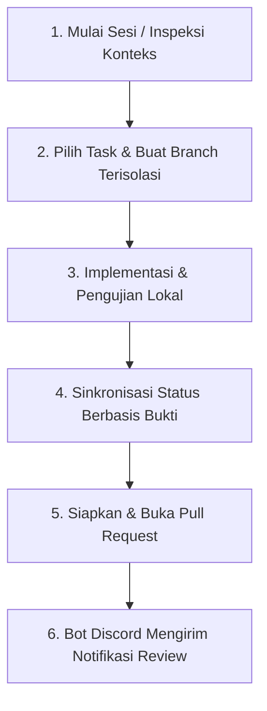

# Daily Developer & Agent Workflow Guide

> **Dokumen:** Alur Kerja Harian Pengembang dan AI Coding Assistant (Antigravity).  
> **Model:** Supervised Autonomous Development Coordination.

---

## 1. Ikhtisar Alur Kerja Harian



---

## 2. Langkah Demi Langkah Pelaksanaan

### Fase 1: Memulai Sesi & Inspeksi Konteks
Sebelum memulai pengkodean, periksa task yang ditugaskan pada Anda dan status branch lokal:

```bash
python3 scripts/agentic/tasks.py
```

Perintah ini akan menampilkan:
- Identitas developer aktif.
- Branch dan worktree yang sedang aktif.
- Daftar issue yang ditugaskan kepada Anda di GitHub (jika online).

---

### Fase 2: Memulai Task Baru
Pilih issue yang akan dikerjakan, lalu buat branch terisolasi yang memenuhi standar penamaan `{type}/{issue}-{slug}`:

```bash
python3 scripts/agentic/start-task.py \
  --type feat \
  --issue 128 \
  --slug mood-tracker-ui
```

Opsi Worktree (opsional, jika ingin direktori kerja terisolasi):
```bash
python3 scripts/agentic/start-task.py \
  --type feat \
  --issue 128 \
  --slug mood-tracker-ui \
  --worktree
```

Jika Anda ingin memindahkan status issue ke `In Progress`:
```bash
python3 scripts/agentic/sync-state.py \
  --state "In Progress" \
  --issue 128
```

---

### Fase 3: Siklus Implementasi & Pengujian
Kerjakan modifikasi kode bersama AI Agent (Antigravity):
- Ikuti arsitektur Clean Architecture dan abstraksi mock vs prod.
- Jalankan test suite lokal secara berkala:
  ```bash
  # Python / Backend
  python3 -m unittest discover -s tests

  # Flutter / Mobile
  flutter test
  ```

---

### Fase 4: Menangani Kendala (Jika Terjadi Blocker)
Jika pekerjaan terhambat oleh dependensi atau keputusan eksternal:

```bash
python3 scripts/agentic/sync-state.py \
  --state "Blocked" \
  --issue 128 \
  --blocker-reason "Menunggu endpoint GraphQL v2 disediakan oleh tim backend"
```

Setelah kendala terselesaikan:
```bash
python3 scripts/agentic/sync-state.py \
  --state "In Progress" \
  --issue 128 \
  --unblock-note "Endpoint GraphQL v2 sudah aktif dan diverifikasi"
```

---

### Fase 5: Mempersiapkan Pull Request (PR)
Setelah seluruh test lulus dan implementasi tuntas, siapkan PR dengan format terstandar:

```bash
python3 scripts/agentic/prepare-pr.py \
  --test-cmd "python3 -m unittest discover -s tests"
```

Script akan:
1. Memvalidasi bahwa working tree bersih (atau konfirmasi uncommitted).
2. Menjalankan test suite otomatis dan merekam output ringkasannya.
3. Mencetak template PR lengkap yang mengaitkan issue terkait (`Closes #128`).

Pindahkan status pekerjaan ke `In Review`:
```bash
python3 scripts/agentic/sync-state.py \
  --state "In Review" \
  --issue 128 \
  --pr-url "https://github.com/Nexa-Code-Studio/eva-ecosystem/pull/15" \
  --test-evidence "Semua 37 unit test lulus"
```

---

### Fase 6: Notifikasi & Review Tim
Saat PR dibuka atau reviewer diminta:
1. GitHub App mendeteksi event `pull_request.review_requested`.
2. Bot Discord menerima webhook secara aman dan memverifikasi tanda tangan HMAC.
3. Bot Discord mengirim notifikasi embed ke kanal tim dan mem-ping reviewer yang telah terhubung via `/account connect`.
