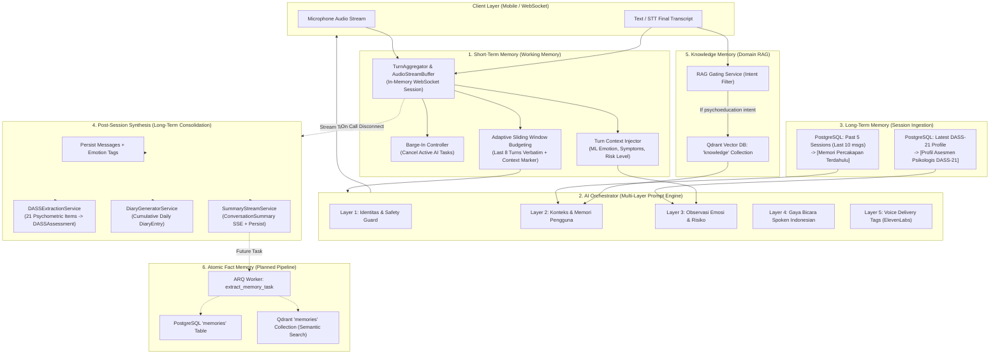

# Status & Arsitektur Orkestrasi Memori AI (Short-Term & Long-Term Memory)

> **Dokumen Status Arsitektur**: Analisis implementasi teknis aktual sistem memori jangka pendek (*Short-Term Memory*) dan memori jangka panjang (*Long-Term Memory*) pada orkestrasi AI Eva/Luna AI.  
> **Tanggal Pembaruan**: 21 November 2026  
> **Workspace**: `packages/ai`, `apps/backend/api`, `apps/backend/workers`, `apps/backend/mcp`

---

## 1. Ringkasan Eksekutif (Executive Summary)

Sistem orkestrasi AI pada Eva AI mengelola konteks percakapan konseling melalui arsitektur memori berlapis (*multi-tiered memory architecture*). Tujuannya adalah menjaga percakapan tetap responsif dan berempati tinggi pada sesi suara *real-time* (latensi rendah), sembari mempertahankan kontinuitas emosional dan riwayat psikologis pengguna lintas sesi.

Secara garis besar, status implementasi saat ini terbagi menjadi dua kategori:
1. **Active Runtime State (Sudah Berjalan di Production / Real-Time Call & Chat)**:
   - *Short-Term Working Memory* berbasis sesi *in-memory* dengan *Adaptive History Budgeting* (sliding window 8 giliran) di `AIOrchestrator`.
   - *Episodic Cross-Session Memory* berbasis relasional PostgreSQL yang memuat 10 pesan terakhir dari 5 sesi terdahulu ke dalam *Layer 2 Prompt*.
   - *Longitudinal Psychometric Memory* yang memuat skor DASS-21 terkini (Depresi, Kecemasan, Stres) dan mengekstraksinya kembali di akhir sesi melalui `DASSExtractionService`.
   - *Reflective Episodic Synthesis* berupa pembuatan jurnal harian kumulatif otomatis (`DiaryEntry`) dan ringkasan sesi (`ConversationSummary`).
2. **Schema & Worker Foundation (Sudah Ada Skema DB, Menunggu Aktivasi Pipeline Asinkron)**:
   - Entitas `Memory` (`memories` table) dengan klasifikasi `MemoryType` (preferensi, fakta pribadi, tujuan, pola emosi).
   - Koleksi vektor Qdrant `memories` untuk pencarian semantik memori atomik berbasis kemiripan vektor.
   - Background task ARQ `extract_memory_task` dan FastMCP tools (`search_memory`, `store_memory`).

---

## 2. Diagram Arsitektur Orkestrasi Memori



---

## 3. Komponen Short-Term Memory (STM / Working Memory)

Short-Term Memory berfokus pada apa yang terjadi **di dalam sesi yang sedang aktif**. Komponen ini dirancang untuk mempertahankan koherensi percakapan tanpa melampaui batas *context window* atau menambah latensi inferensi.

### 3.1 Session-Level Dialogue State (`CallSession`)
- **Lokasi Kode**: [`apps/backend/api/app/services/call/session_manager.py`](file:///home/mashupsoat/Project/eva-ecosystem/apps/backend/api/app/services/call/session_manager.py)
- **Struktur**: `CallSession.conversation_history: list[LLMMessage]`
- **Mekanisme**:
  - Menyimpan urutan percakapan giliran per giliran (*turn-by-turn*) dalam memori server selama koneksi WebSocket aktif.
  - Memiliki `TurnAggregator` untuk menggabungkan potongan transkrip *Speech-to-Text* (STT parsial vs final) sebelum diserahkan ke model.
  - Mendukung mekanisme **Barge-In Cancellation**: Jika pengguna memotong pembicaraan saat AI sedang berbicara, task LLM dan audio player yang sedang aktif segera dibatalkan (`cancel_active_ai_task()`).

### 3.2 Adaptive History Budgeting & Sliding Window
- **Lokasi Kode**: [`packages/ai/orchestration/orchestrator.py`](file:///home/mashupsoat/Project/eva-ecosystem/packages/ai/orchestration/orchestrator.py#L509-L527)
- **Implementasi**:
  ```python
  # Retain recent turns verbatim (sliding window last 8 turns), summarize older if long
  if len(raw_turns) > 8:
      messages.append(
          LLMMessage(
              role="system",
              content=f"[Konteks Sesi Berjalan]: Sesi ini telah berlangsung {len(raw_turns)} giliran interaktif. "
                      f"Pertahankan kesinambungan cerita dan rujuk hal-hal yang telah dibicarakan sebelumnya secara konsisten.",
          )
      )
      messages.extend(raw_turns[-8:])
  else:
      messages.extend(raw_turns)
  ```
- **Karakteristik**:
  - Menjaga maksimal 8 giliran dialog terakhir secara harfiah (*verbatim*) untuk mencegah inflasi token pada panggilan telepon panjang (> 15 menit).
  - Menyisipkan *anchor prompt* `[Konteks Sesi Berjalan]` agar LLM memahami bahwa sesi sudah berlangsung lama dan tidak menyapa ulang pengguna seperti sesi baru.

### 3.3 Dynamic Turn-Level Context Injection
- Setiap giliran baru mengevaluasi:
  1. **Deteksi Emosi Real-time** (`MLEmotionDetectorService`): Memeriksa teks dan sinyal audio mikrofon pengguna (misal: *sadness*, *fearful*, *neutral*).
  2. **Ekstraksi Gejala Klinis** (`SymptomService`): Taksonomi WHO-EASE.
  3. **Triage Risiko & Safety Gate** (`RiskAssessmentService`, `SafetyGate`): Menentukan apakah situasi tergolong krisis (*self-harm*, *suicidal ideation*).
  4. Hasil evaluasi disuntikkan secara dinamis pada giliran tersebut ke dalam prompt tanpa perlu disimpan secara permanen sebagai histori pesan biasa.

---

## 4. Komponen Long-Term Memory (LTM / Persistent & Episodic Memory)

Long-Term Memory bertanggung jawab membawa konteks dari **sesi-sesi masa lalu pengguna ke dalam percakapan saat ini**, serta mengkristalisasi hasil sesi ke dalam bentuk pengetahuan jangka panjang.

### 4.1 Cross-Session Episodic Recall (Memori Lintas Sesi)
- **Lokasi Kode**: [`apps/backend/api/app/services/call/persistence.py`](file:///home/mashupsoat/Project/eva-ecosystem/apps/backend/api/app/services/call/persistence.py#L53-L74)
- **Implementasi**:
  - Saat sesi WebSocket dimulai (`load_conversation_history`), server membaca 5 percakapan terakhir milik pengguna dari tabel PostgreSQL `conversations`:
    ```python
    conv_query = (
        select(Conversation)
        .options(selectinload(Conversation.messages))
        .where(Conversation.user_id == user.id)
        .order_by(Conversation.started_at.desc())
    )
    ```
  - Mengambil maksimal 10 pesan terakhir (`all_past_msgs[-10:]`), dipotong hingga batas aman 1.000 karakter, dan disuntikkan ke dalam pesan sistem awal:
    ```text
    [Memori Percakapan Terdahulu Pengguna]:
    user: aku lagi cemas soal skripsiku...
    assistant: tenang, kita uraikan satu per satu ya...
    ```
  - Pada `AIOrchestrator`, bagian ini diposisikan pada **Layer 2 (Prioritas Percakapan & Konteks)**, memberikan AI kemampuan mengenali masalah yang belum tuntas dari percakapan sebelumnya.

### 4.2 Longitudinal Psychometric Memory (Profil Skrining DASS-21)
- **Lokasi Kode**:
  - Pembacaan: [`apps/backend/api/app/services/call/persistence.py`](file:///home/mashupsoat/Project/eva-ecosystem/apps/backend/api/app/services/call/persistence.py#L76-L105)
  - Ekstraksi Pasca-Sesi: [`apps/backend/api/app/services/call/persistence.py`](file:///home/mashupsoat/Project/eva-ecosystem/apps/backend/api/app/services/call/persistence.py#L295-L329) & [`packages/ai/services/dass_extraction_service.py`](file:///home/mashupsoat/Project/eva-ecosystem/packages/ai/services/dass_extraction_service.py)
- **Implementasi**:
  - Membaca record `DASSAssessment` terbaru pengguna (Depresi, Kecemasan, Stres).
  - Disuntikkan ke prompt:
    ```text
    [Profil Asesmen Psikologis DASS-21 Terkini Pengguna]:
    - Tingkat Depresi: Sedang (Skor: 14)
    - Tingkat Kecemasan: Berat (Skor: 16)
    - Tingkat Stres: Ringan (Skor: 12)
    Gunakan profil ini sebagai acuan empati dan gaya berbicara (DILARANG menyebut angka skor secara kaku).
    ```
  - Saat sesi panggilan berakhir (*on disconnect*), `DASSExtractionService` menganalisis keseluruhan transkrip percakapan, mengekstraksi 21 butir instrumen DASS secara otomatis, lalu memperbarui tabel `dass_assessments` hari tersebut.

### 4.3 Reflective Episodic Synthesis (Sintesis Jurnal Harian & Ringkasan)
- **Lokasi Kode**: [`apps/backend/api/app/services/diary/generator_service.py`](file:///home/mashupsoat/Project/eva-ecosystem/apps/backend/api/app/services/diary/generator_service.py) & [`apps/backend/api/app/services/conversation/summary_stream_service.py`](file:///home/mashupsoat/Project/eva-ecosystem/apps/backend/api/app/services/conversation/summary_stream_service.py)
- **Implementasi**:
  - **Daily Diary Entry (`DiaryEntry`)**: Setelah panggilan selesai, `sync_today_diary` mengumpulkan seluruh sesi pada tanggal WIB yang sama, menghasilkan satu jurnal harian kumulatif yang berisi:
    - `mood_tag` & `mood_emoji`
    - `title` & `summary`
    - `ai_insight` & `emotional_reflection`
    - `important_events`
  - **Conversation Summary (`ConversationSummary`)**: Menghasilkan ringkasan 2–3 kalimat yang di-stream via SSE (`/conversations/{id}/summary/stream`) menggunakan model LLM dan disimpan ke database untuk pengingat cepat di riwayat chat aplikasi mobile.

---

## 5. Domain Knowledge Memory (RAG / Psychoeducation Knowledge)

- **Lokasi Kode**: [`packages/ai/services/rag.py`](file:///home/mashupsoat/Project/eva-ecosystem/packages/ai/services/rag.py), [`packages/ai/services/rag_gating.py`](file:///home/mashupsoat/Project/eva-ecosystem/packages/ai/services/rag_gating.py), [`packages/ai/vector_store/qdrant.py`](file:///home/mashupsoat/Project/eva-ecosystem/packages/ai/vector_store/qdrant.py)
- **Mekanisme**:
  - Pengetahuan psikoedukasi dan teknik koping disimpan dalam koleksi vektor **Qdrant** (`knowledge`).
  - **RAG Intent Gating**: Sebelum melakukan pencarian vektor, `RAGGatingService` mengevaluasi maksud pengguna. Jika pengguna hanya curhat atau menyapa santai, pencarian RAG **dilewati (*skipped*)** untuk memangkas latensi panggilan suara hingga ~400ms.
  - Jika pengguna meminta teknik atau penjelasan mekanisme emosi (dan status keselamatan aman), konteks pengetahuan diambil dan disematkan ke Layer 2 prompt.

---

## 6. Perbandingan Status: Current State vs. Architecture Specification

Berikut adalah matriks komparasi antara apa yang **aktif di runtime hari ini** dengan apa yang **telah terdefinisi pada spesifikasi arsitektur (`docs/backend_spec.md` & `docs/ai_counseling_business_logic.md`)**:

| Fitur Memori | Spesifikasi Arsitektur | Status Implementasi Saat Ini | Keterangan & Lokasi Kode |
| :--- | :--- | :--- | :--- |
| **Short-Term Context Window** | Sliding window / Adaptive budget | ✅ **Aktif di Runtime** | `AIOrchestrator` (8 turn sliding window) di `packages/ai/orchestration/orchestrator.py` |
| **Barge-in Interrupt Handling** | Batalkan respon saat dipotong suara | ✅ **Aktif di Runtime** | `CallSession.cancel_active_ai_task()` di `apps/backend/api/app/services/call/session_manager.py` |
| **Turn Emotion & Risk State** | Real-time classification per pesan | ✅ **Aktif di Runtime** | ML Emotion + Risk + SafetyGate di `AIOrchestrator.prepare_turn` |
| **Cross-Session Conversational LTM** | Ambil riwayat chat lampau pengguna | ✅ **Aktif di Runtime** | PostgreSQL query (5 sesi lampau, 10 pesan, 1000 char) di `CallPersistenceService` |
| **Psychometric Longitudinal Memory** | Tracking tren depresi/stres DASS-21 | ✅ **Aktif di Runtime** | Pemuatan awal + ekstraksi otomatis pasca-panggilan via `DASSExtractionService` |
| **Reflective Diary Synthesis** | Auto-generate jurnal harian terstruktur | ✅ **Aktif di Runtime** | Disinkronkan tiap selesai panggilan di `CallPersistenceService.sync_today_diary` |
| **Conversation Summary** | Ringkasan sesi via SSE & DB | ✅ **Aktif di Runtime** | `SummaryStreamService` token-by-token SSE + model `ConversationSummary` |
| **Atomic Fact Memory (`memories` table)** | Ekstraksi fakta spesifik (`UserMemory`) | ⚠️ **Schema Ready, Pipeline Standby** | Model SQLAlchemy `Memory` (`MemoryType` enum) sudah ada di `app/models/memory.py` |
| **Semantic Memory Vector Search** | Qdrant `memories` collection | ⚠️ **Spec & Client Ready, Not Linked** | Konektor Qdrant tersedia di `packages/ai/vector_store/qdrant.py`, belum dipanggil di `AIOrchestrator` |
| **Async Background Memory Worker** | ARQ `extract_memory_task` | ⚠️ **Placeholder Task** | Definisi fungsi ada di `apps/backend/workers/app/tasks/summarization.py`, isi fungsi masih mock |
| **MCP Memory Tools** | `search_memory`, `store_memory` via FastMCP | ⚠️ **Spesifikasi Tertera** | `apps/backend/mcp/app/main.py` baru meregistrasikan `get_system_status` |

---

## 7. Rencana Pengembangan Lanjutan (Roadmap Memori AI)

Untuk menyempurnakan siklus memori dari pendekatan *direct-DB query* menuju *autonomous semantic memory*, langkah evolusi berikutnya mencakup:

1. **Aktivasi ARQ Worker `extract_memory_task`**:
   - Menghubungkan *event* pasca-panggilan suara atau pengiriman chat ke antrean Redis ARQ.
   - Menjalankan prompt ekstraksi memori berbasis LLM untuk mendeteksi fakta penting pengguna (misal: "Pengguna memiliki trauma kecelakaan mobil", "Pengguna menyukai musik instrumental untuk relaksasi").
   - Menyimpan poin memori ke tabel `memories` dan membuat embedding vektornya ke Qdrant koleksi `memories`.
2. **Integrasi Pencarian Semantik Memori di `AIOrchestrator`**:
   - Menambahkan langkah pengambilan vektor memori atomik pada fase `prepare_turn` sebelum formulasi prompt.
   - Menyaring memori yang paling relevan secara semantik dengan ucapan pengguna saat ini (misal: jika pengguna berbicara tentang "skripsi", sistem hanya menarik memori tentang "tenggat waktu tesis dan dosen pembimbing").
3. **Eksposisi FastMCP Tooling**:
   - Membuka endpoint `search_memory` dan `store_memory` pada FastMCP server (:8889) agar agen AI luar atau sub-agen dapat membaca dan menulis memori secara terkontrol.
